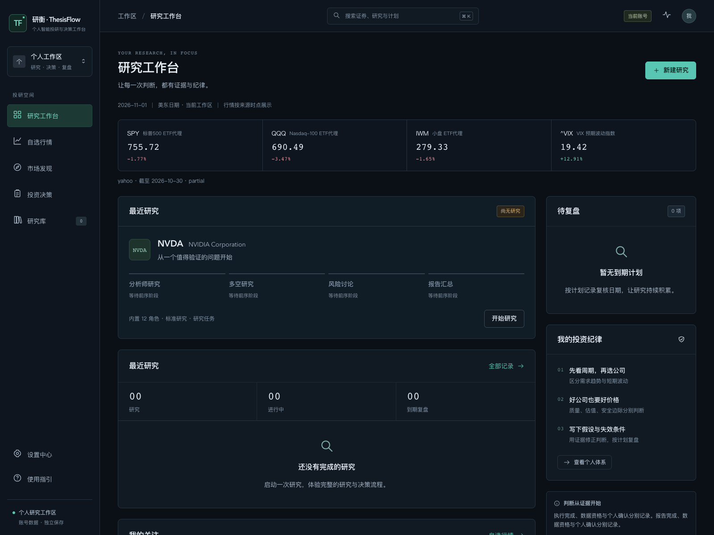
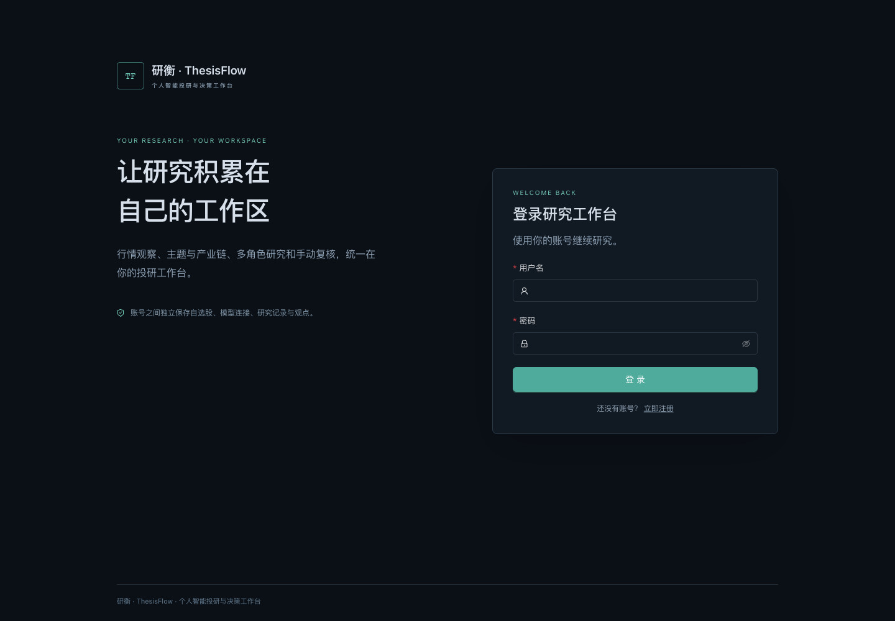
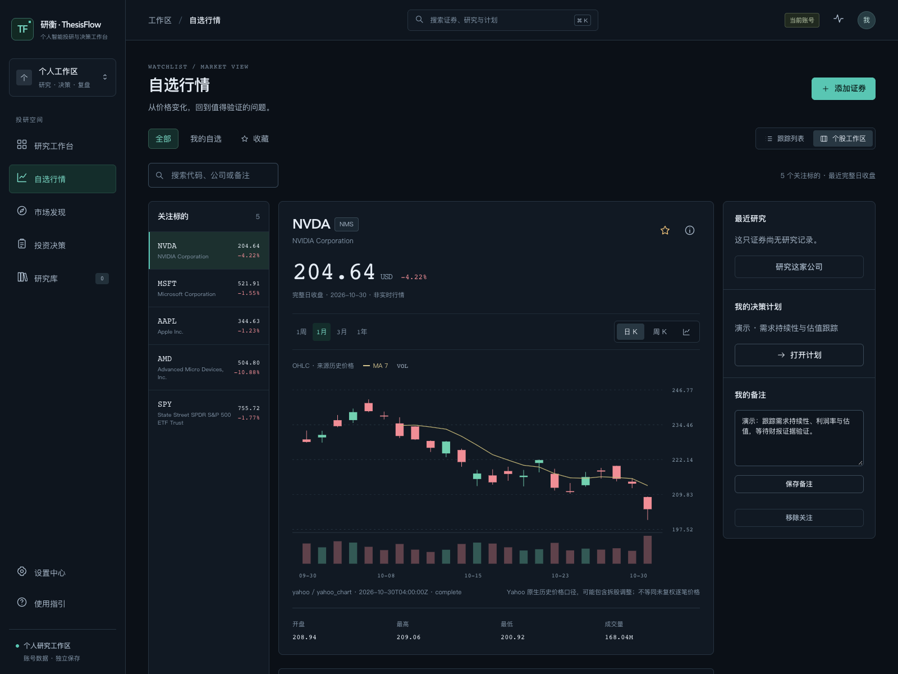
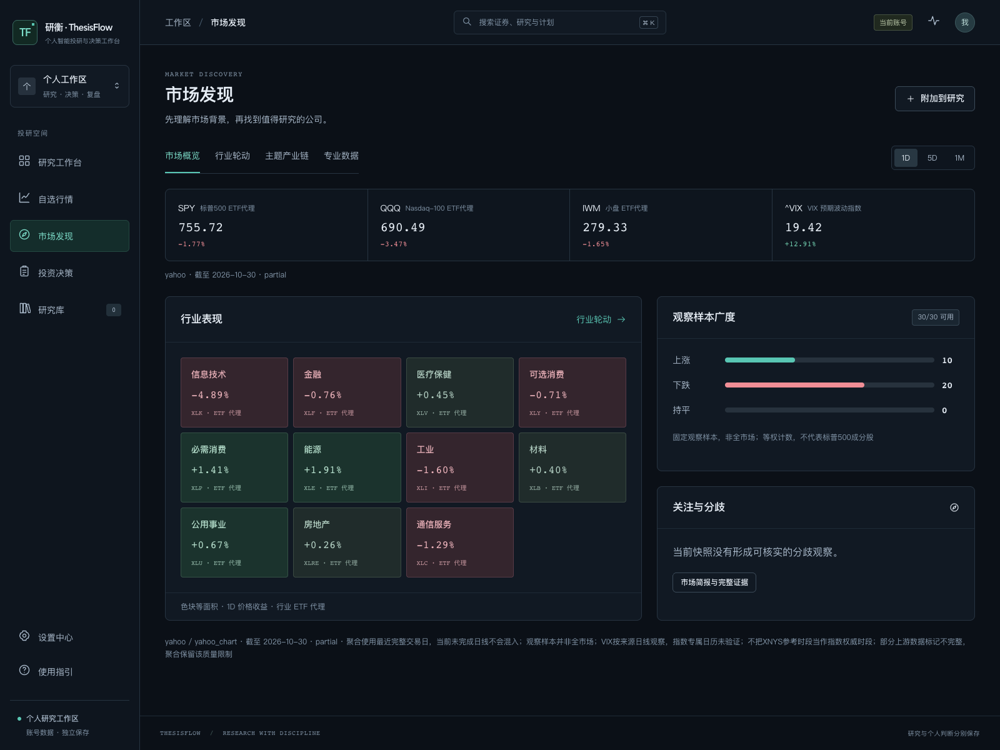
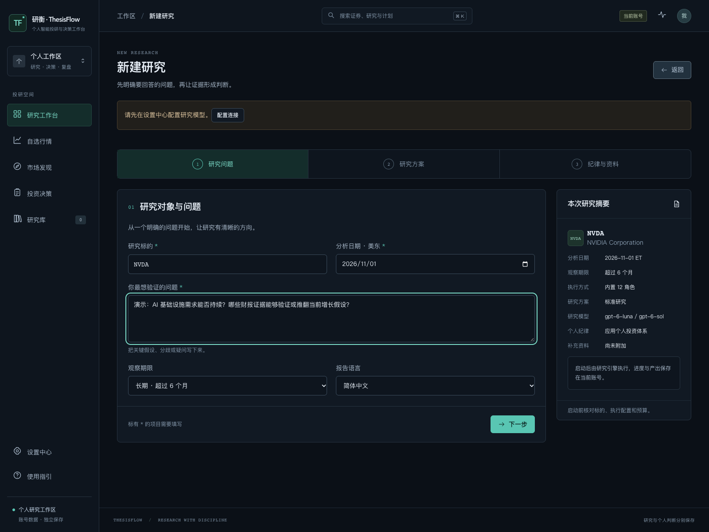
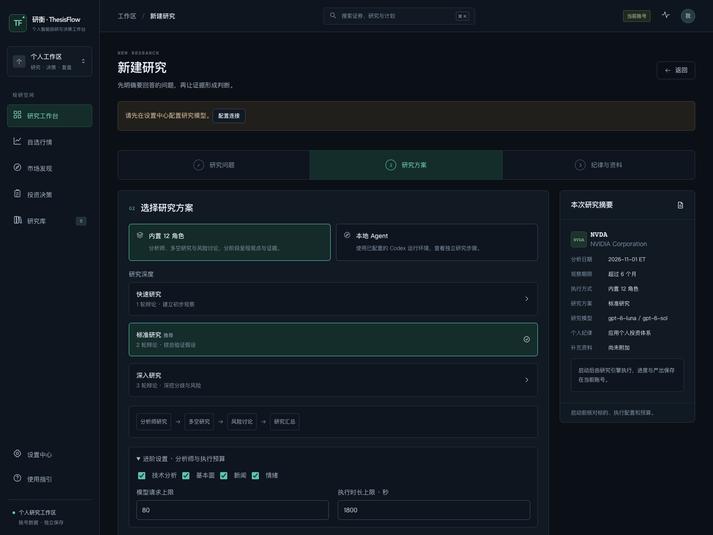
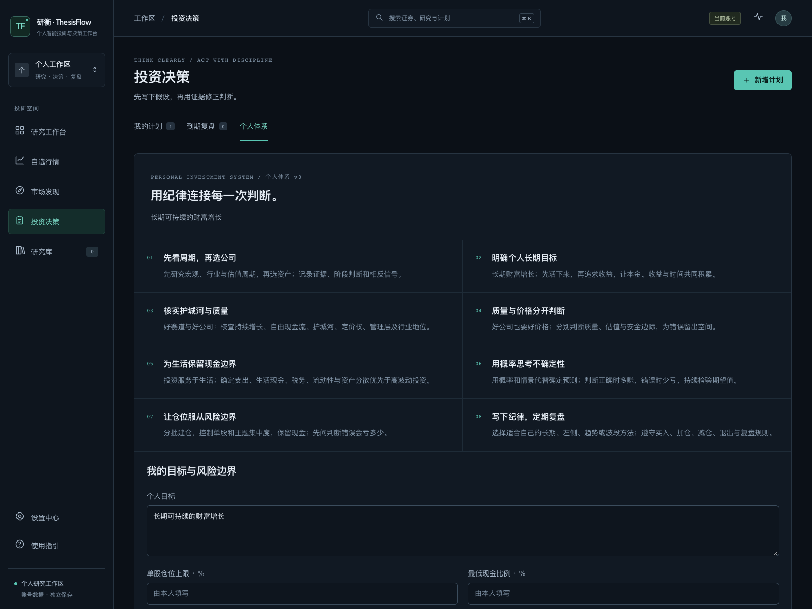
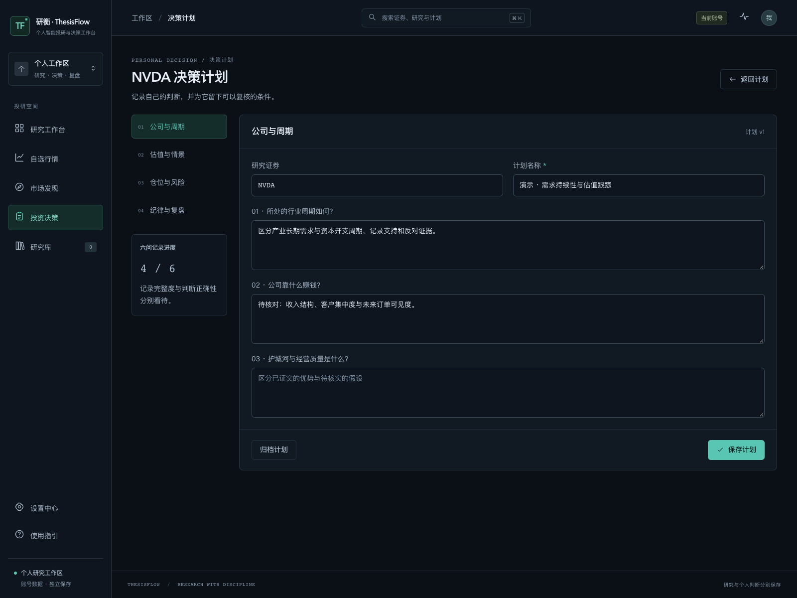
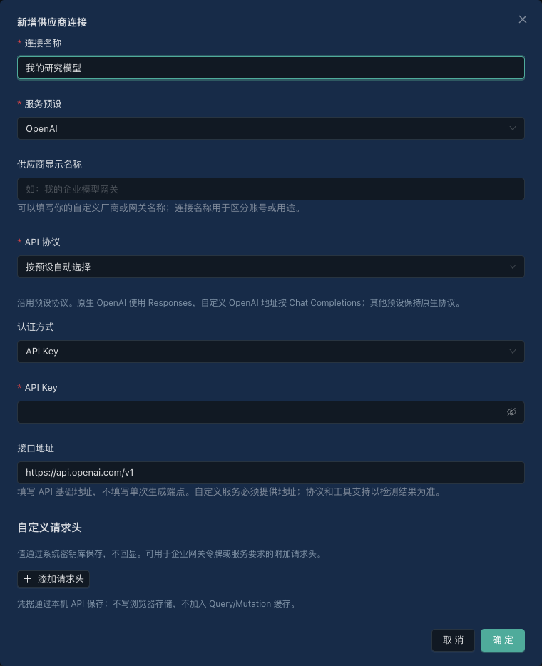

# 研衡 · ThesisFlow

**让每一次投资判断，都有证据与纪律。**

研衡（ThesisFlow）是一个面向个人投资者的美股投研工作台，将发现机会、研究验证、投资决策和跟踪复盘连接起来，提供独立的产品界面、账号工作区和研究管理功能。

项目仓库：[ninthmonee/thesisflow](https://github.com/ninthmonee/thesisflow) · [来源与许可](#来源与许可) · [命名说明](docs/brand.md)



## 目录

- [项目功能与界面展示](#项目功能与界面展示)
- [安装与启动](#安装与启动)
- [首次设置与账号登录](#首次设置与账号登录)
- [第一次使用：完成一轮投研](#第一次使用完成一轮投研)
- [功能使用详解](#功能使用详解)
- [模型与数据源配置](#模型与数据源配置)
- [本地 Agent 独立研究](#本地-agent-独立研究)
- [日常维护与备份](#日常维护与备份)
- [常见问题](#常见问题)
- [项目结构与开发](#项目结构与开发)
- [进一步阅读](#进一步阅读)
- [来源与许可](#来源与许可)

## 项目功能与界面展示

研衡围绕一条工作流组织功能：**发现机会 → 研究验证 → 形成个人决策 → 跟踪复盘**。你可以先使用行情、自选和计划管理，再按需接入模型进行研究。

| 功能入口 | 可以做什么 |
| --- | --- |
| 研究工作台 | 查看市场背景、最近研究、进行中的任务、关注证券和到期复核计划 |
| 自选行情 | 搜索并添加股票 / ETF，管理分组与收藏，记录备注，查看价格、成交量和个股图表 |
| 市场发现 | 浏览市场概览、11 个行业 ETF 代理、主题与产业链，以及期权、ETF 份额流和新闻样本 |
| 新建研究 | 明确研究问题，选择内置 12 角色或本地 Agent，设置深度、分析师、预算和补充资料 |
| 研究库 | 重开历史报告，核对结论、证据、过程与个人观点，导出报告或进行同股研究对照 |
| 投资决策 | 保存个人投资体系、个股计划、情景假设、风险边界和手动复盘记录 |
| 设置中心 | 管理模型连接、角色配置、运行环境、数据来源、缓存及个人账号 |

默认入口是 Open Design 版深色工作台。模型、数据源、完整图表和部分专业管理功能通过工作台内的配置浮层打开，也可使用 `/workbench/advanced/` 下的完整 React 页面。

<details>
<summary>展开查看 8 张主要功能截图（点击图片可查看原图）</summary>

| 账号登录与独立工作区 | 自选行情与个股图表 |
| :---: | :---: |
| [](docs/images/readme/login.png) | [](docs/images/readme/watchlist.png) |

| 市场发现与行业观察 | 明确研究问题 |
| :---: | :---: |
| [](docs/images/readme/market.png) | [](docs/images/readme/research.png) |

| 研究方案与执行预算 | 个人投资体系 |
| :---: | :---: |
| [](docs/images/readme/research-modes.png) | [](docs/images/readme/investment.png) |

| 个股决策计划 | 模型连接配置 |
| :---: | :---: |
| [](docs/images/readme/plan.png) | [](docs/images/readme/model-settings.png) |

</details>

以上截图于 **2026-11-02** 从实际运行并登录的独立演示工作区采集。自选和标注“演示”的计划通过真实后端保存；行情以画面中的来源、日期和质量标识为准。本次展示未启动真实模型研究，待配置状态和空研究库保留原样。

## 安装与启动

### 环境要求

| 依赖 | 要求与用途 |
| --- | --- |
| Python | 推荐 3.13；后端包声明的最低版本为 3.11，锁文件以已验收环境为准 |
| Node.js | 24.x，用于安装和构建前端 |
| npm | 前端锁文件对应 npm 11.19.1 |
| uv | 创建 Python 虚拟环境并安装后端依赖 |
| 浏览器 | 使用现代浏览器访问本机工作台 |
| 模型 / 数据账号 | 行情与计划管理可先使用；模型研究及部分专业数据需要自行配置连接 |

下面的命令在 macOS / Linux 终端执行。配置示例见 [`backend/.env.example`](backend/.env.example)；网页中保存的模型和数据凭据由后端使用系统密钥库管理。

### 1. 获取源码并安装后端

```bash
git clone https://github.com/ninthmonee/thesisflow.git
cd thesisflow

uv venv --python 3.13 backend/.venv
uv pip install --python backend/.venv/bin/python -r backend/requirements.lock
uv pip install --python backend/.venv/bin/python -e 'backend[web,dev]'
```

已有 `backend/.venv` 时跳过创建步骤。`backend/requirements.lock` 记录已验收的精确依赖；其他平台的依赖与运行说明见[本机运行文档](docs/web-local-operation.md)。

### 2. 安装和构建前端

```bash
npm --prefix frontend ci --ignore-scripts
npm --prefix frontend run vendor:patch
backend/.venv/bin/python backend/scripts/export_openapi.py --check
backend/.venv/bin/python backend/scripts/package_workbench.py
```

每次 `npm ci` 后都要执行 `vendor:patch`，应用仓库中已审查的第三方类型声明补丁。打包脚本会构建前端并复制新版与旧版界面的发布资源。

### 3. 启动工作台

macOS 在项目根目录执行，也可双击 `start-workbench.command`：

```bash
./start-workbench.command
```

Linux 可直接运行同一个 Python 启动器：

```bash
backend/.venv/bin/python backend/scripts/run_workbench.py
```

浏览器打开 **[http://127.0.0.1:8001/workbench/](http://127.0.0.1:8001/workbench/)**。启动器同时管理 API 和独立研究 worker，在启动终端按 **Ctrl+C** 停止两者。关闭浏览器不会停止已经提交的研究。

默认状态目录为 `data/web/development/`，数据库位于 `data/web/development/web/workbench.sqlite3`。需要另一套独立工作区或其他端口时：

```bash
backend/.venv/bin/python backend/scripts/run_workbench.py \
  --port 8002 \
  --state-dir data/web/another-workspace
```

此时访问 `http://127.0.0.1:8002/workbench/`，初始化命令也须使用该状态目录下的数据库。

## 首次设置与账号登录

### 创建首个管理员

项目**没有预设用户名和默认密码**。首次打开未初始化的实例时，页面进入“创建管理员账号”：

1. 保持工作台启动，在本机另一个终端进入项目根目录。
2. 执行下方命令取得一次性初始化凭证。
3. 将凭证直接填入页面，设置自己的用户名、显示名称与密码。
4. 创建成功后进入工作区，凭证随即失效；之后使用用户名和密码登录。

```bash
backend/.venv/bin/python backend/scripts/account_setup.py \
  --database data/web/development/web/workbench.sqlite3 \
  --show-token
```

初始化凭证仅在本机使用，不要加入截图、聊天记录或代码仓库。自定义状态目录时替换数据库路径。首个管理员会接管该实例原有的本机自选、研究历史和连接配置。

### 注册与日常登录

- 管理员完成初始化后，默认开放注册；在登录页点击“立即注册”即可创建独立账号，无需邀请码。
- 用户名为 3–32 位英文字母、数字、点、下划线或短横线，首位为字母或数字，保存为小写。
- 新密码为 12–128 个字符，不能全为空白；显示名称可选。
- 新注册账号自动登录，从空自选和独立研究记录开始，模型及数据连接由本人配置。
- 顶栏账号入口或“设置中心 → 个人账号 → 账号与安全”可修改密码、退出当前会话或退出所有会话；管理员还可开放 / 关闭注册。

账号之间独立保存业务记录和凭据。新账号不会继承主人的环境密钥、模型连接或本机订阅授权。当前服务仅监听 `127.0.0.1`，开放注册用于本机账号切换；远程访问、共享工作区和邮箱找回尚未交付。

## 第一次使用：完成一轮投研

以跟踪一家公司为例，可以按下面的顺序操作：

1. **配置研究模型**：进入“设置中心 → 模型与研究 → 编辑配置”，保存供应商连接，新增模型，检测聊天 / 工具能力，再保存默认研究配置。
2. **建立关注列表**：进入“自选行情 → 添加证券”，搜索 `NVDA` 等公司代码，选中结果后加入关注，填写需要验证的问题或备注。
3. **提出具体问题**：点击“研究这家公司”或首页“新建研究”，例如“需求能否持续？哪些财报证据能够验证或推翻增长假设？”
4. **核对方案并启动**：确认美东分析日期、观察期限、语言、执行方式和预算，按需关联个人投资体系及计划，最后点击“启动研究”。
5. **阅读并核验结果**：在“研究库”打开记录，依次查看“结论、证据、过程、我的决策”，核对数据时点、缺失项和原始模型判断。
6. **保存个人决策并复盘**：建立个股计划，记录自己的论点、失效条件、情景和复核日期；到期后补充新证据并手动记录复盘。

不接入模型时，可以先完成自选、市场浏览和手动计划管理。模型能力检测、正式研究和主动生成的市场简报可能使用供应商额度；填写表单或查看已有报告不会自动重新研究。

## 功能使用详解

### 自选行情与个股工作区

在左侧选择“自选行情”，可以在“跟踪列表”和“个股工作区”间切换：

- **添加与组织**：搜索代码或公司名添加股票 / ETF；通过“完整行情与分组管理”维护分组、新增成员和排序。
- **筛选与记录**：按分组、收藏、代码、公司或备注查找标的；收藏和备注按当前账号与证券保存，可跨分组使用。
- **查看图表**：主界面提供日 / 周 K 线、价格 / 成交量与均线观察；更多分钟周期、技术指标参数和 SPY 对比位于完整行情面板。
- **接续工作**：个股侧栏可打开最近研究、已有计划，或直接发起该公司的研究。

完整图表支持 SMA、EMA、BOLL、RSI、MACD、ATR 等指标，并按来源能力提供周期、历史范围、时段和调整选项。查看条件保存在 URL 中，刷新可恢复；分钟历史受来源窗口和最多 5,000 根 K 线约束。

列表价格使用**最近完整交易日收盘**，图表可能包含尚未完成的当日 K 线。行情显示来源、数据时点和质量状态；SPY 对比使用双方共同完整 K 线计算价格收益。缺失值不会补成虚假价格，机械趋势与波动参考也不代表已验证的预测。

### 市场发现、行业与主题

| 页签 | 使用方式与口径 |
| --- | --- |
| 市场概览 | 查看 SPY、QQQ、IWM 与 VIX 背景、行业表现和固定观察样本广度；广度样本不代表全市场 |
| 行业轮动 | 用 11 个行业 ETF 代理观察价格收益、相对 SPY 表现及成交关注，切换 1D / 5D / 1M 窗口 |
| 主题产业链 | 搜索预置主题，查看成员与关系证据；在完整管理页新建、复制、编辑、置顶、删除或恢复主题 |
| 专业数据 | 按来源查看 ETF 份额流估算、期权链和新闻情绪样本，先检查所需账号权限与覆盖 |

当前提供 30 个预置主题，自建主题与个股关系可逐步维护。主题观察按当前成员等权比较，手工编辑的关系保留待核实标识。

需要把市场背景带入研究时，主动使用“附加到研究”，在创建研究时确认或移除已冻结的来源快照。历史研究不能使用晚于研究日期才捕获的资料。市场模型简报需在完整面板主动生成。

### 三步创建研究

| 步骤 | 需要核对的内容 |
| --- | --- |
| 1. 研究问题 | 公司股票代码、美东分析日期、要验证的问题、观察期限和报告语言 |
| 2. 研究方案 | 内置 12 角色 / 本地 Agent；内置流程可选深度，并展开分析师和执行预算设置 |
| 3. 纪律与资料 | 是否应用个人投资体系、关联同股决策计划、保留哪些补充来源快照，最后核对摘要并提交 |

分析日期以 **America/New_York** 为准，可能与上海日期不同。ETF 和指数用于行情及市场背景，公司基本面研究应选择具体公司股票。

内置研究保留以下角色分工：

| 阶段 | 角色与作用 |
| --- | --- |
| 分析取证 | 技术、基本面、新闻、情绪分析师；所选分析师分别取证后汇合 |
| 多空研究 | 多头与空头研究员交换论点，研究经理汇总分歧 |
| 交易提案 | 交易员整理研究形成计划提案 |
| 风险讨论 | 激进、保守、中立风险分析员审视不同风险偏好 |
| 最终汇总 | 组合经理综合前述材料形成研究输出 |

快速、标准、深入研究分别对应 1、2、3 轮辩论。**12 种角色不等于固定 12 次模型调用**，工具循环、补充响应和反思也可能产生请求。模型请求上限、执行时长及完整页面提供的其他预算项须在提交前核对。

已提交的研究由独立 worker 执行，可以离开页面后返回查看。取消在可中止边界生效，不能撤销已经发生的用量。每个账号最多同时保留 3 个待处理研究；恢复执行需要兼容的完整检查点，否则通过“重新研究”核对后创建新任务。

### 研究库、报告与证据

在“研究库”中搜索和筛选自己的记录，打开报告后按四个页签阅读：

| 页签 | 重点查看 |
| --- | --- |
| 结论 | 已保存的报告章节、研究日期、数据资格、有效判断与原始模型判断 |
| 证据 | 本次捕获的来源、方法、数据时点和状态；“完整证据与附件”提供后续分页与正文查看 |
| 过程 | 执行阶段、实际事件、错误、模型 / 运行配置和已记录用量 |
| 我的决策 | 个人论点、立场、失效条件、复核日期与确认记录 |

“执行完成”表示任务结束；数据资格和个人确认各自记录。证据不足或未核验时，原始报告仍可阅读，系统不会据此授予有效评级。

可以导出 Markdown 报告，在完整研究详情中查看 / 导出 HTML，并对同一股票的不同研究进行对照。“重新研究”先回到表单核对原参数或当前配置，不会直接开始新一轮调用。当前证据保存范围有界，尚不支持保证全部原始输入一致的公平复跑。

### 投资体系、决策计划与手动复盘

进入“投资决策 → 个人体系”，先查看八项原则，再保存自己的长期目标、单股仓位上限、最低现金比例和默认复核间隔。更多原则、操作规则与风险字段可在[完整投资体系页面](http://127.0.0.1:8001/workbench/advanced/investment)维护。空阈值表示尚未配置。

点击“新增计划”，或从研究报告建立计划，按四个章节逐步记录：

1. **公司与周期**：公司如何赚钱、所处行业周期、护城河与经营质量，以及计划名称。
2. **估值与情景**：个人参考价格、公允价值假设、悲观 / 基准 / 乐观情景及概率。
3. **仓位与风险**：计划仓位与失效条件，并核对个人风险边界。
4. **纪律与复盘**：下次手动复核日期、计划状态和复盘记录；填写记录后可标记本次已完成复盘。

三情景价格和概率完整、概率合计 100% 后才计算毛期望收益；费用未知时净期望收益保持未知。手填价格、概率与仓位都是个人假设，保存完整度与判断正确性分别展示。

体系每次保存形成新版本，计划和研究保留各自采用的规则快照。修改当前体系不会改写历史研究。复核到期会显示在页面，不会自动发起研究、发送后台提醒或下单；归档计划可以恢复。

## 模型与数据源配置

### 模型连接：先连接，再模型，最后研究配置

入口：“设置中心 → 模型与研究 → 编辑配置”。一个通过检测的模型即可作为全体角色的默认模型，之后再按需覆盖角色：

1. 点击“新增连接”，填写连接名称，选择服务预设或自定义服务。
2. 核对 **API 协议**、API 基础地址和认证方式。项目适配 Chat Completions、Responses、Anthropic Messages、Google GenAI；自定义私有协议需要额外适配。
3. 保存连接，再点击“新增模型”，填写该服务实际可用的模型 ID。服务名称或预设不保证账号能调用某个模型。
4. 分别检测聊天和工具能力。检测会发出真实请求，可能占用模型额度；更换地址、模型或凭据后需重测。
5. 在“基础研究配置”选择默认模型、分析师、深度和语言，保存配置；混用模型时展开“12 角色模型覆盖”。

| 字段 | 填写说明 |
| --- | --- |
| 连接名称 | 用于区分账号或用途，例如“我的研究模型” |
| 供应商显示名称 | 可自定义厂商 / 网关名称，不改变底层协议 |
| 接口地址 | 填 API 基础地址；不要填单次生成请求的完整路径 |
| 认证方式 | 按服务选择 API Key、自定义请求头或明确无需认证 |
| 模型 ID | 以服务实际提供的名称为准，聊天与工具能力单独检测 |
| 默认模型 / 角色覆盖 | 先设一个默认模型，再按需要为特定角色覆盖 |

API Key 与请求头值保存在后端系统密钥库，不回显、不写入浏览器持久缓存。新任务冻结创建时的模板版本；后续修改模板不会替换旧任务配置。网页连接与 CLI 的环境配置是不同的配置入口。

原本机所有者还可选择已支持的本机订阅授权路径；按页面提示自行在终端登录，再保存模型并检测能力。工作台账号登录、供应商授权和模型能力检测是三个独立步骤，普通注册账号不能借用主人的授权。具体条件见[本机运行说明](docs/web-local-operation.md)。

### 数据源：行情、研究资料和专业账号分别管理

入口：“设置中心 → 数据来源 → 管理数据源”。缓存时效、并发、超时及可重建行情缓存位于“缓存与数据设置”。

| 来源 | 当前用途 | 配置要点 |
| --- | --- | --- |
| Yahoo | 个人本机试用的历史行情、部分公开新闻 / 公司资料与期权链 | 注意来源时点、缺失字段、历史窗口和限流；无实时延迟保证 |
| SEC EDGAR | 美国公司披露与财报 | 无需 API Key，须自行配置应用名称及联系身份 |
| FRED | 宏观经济序列 | 在研究数据连接中保存自己的 Key |
| Alpha Vantage | 研究数据适配 | 取决于账号权限、额度和具体接口覆盖 |
| TypeSafe Jev | 可选的社交帖文筛选 | 配置 Key、适配入口和模型；未配置时不视为已接通 |
| iShares 公开文件 | 当前 SOXX / IVV 的日级份额流估算 | 使用份额变化与前日 NAV 估算，不等同精确现金净申赎 |
| Massive / Intrinio / Alpaca | 供应商新闻、期权或 ETF 等专业数据 | 使用自己的现有账号；可用范围取决于套餐、feed 和实际权限 |

先保存本人凭据，再检测并检查返回的覆盖与状态。保存连接不等于检测通过，系统不会自动购买服务。期权指标仅代表本次返回合约，新闻情绪仅代表来源样本，成交量或估算成交额不等于资金净流入。

研究会冻结所用连接与资料引用；未配置、停用或清除的 Web 数据连接不会偷偷使用环境中的旧 Key。缓存清理只针对可重建行情，保留研究记录与冻结证据。详细口径见[数据来源说明](docs/data-source-research-2026-10-25.md)和[运行文档](docs/web-local-operation.md)。

## 本地 Agent 独立研究

入口：“设置中心 → 电脑与运行环境 → 管理运行环境”。当前首个适配器使用 Codex app-server 的 stdio 协议，**仅原本机工作区主人可配置和执行**，受支持的程序版本以环境检测为准。

1. 新建运行环境，填写连接名称、实际模型 ID；程序路径留空自动发现，或填写受支持可执行文件的真实路径。
2. 选择“本连接专属 Codex 登录”，保存后按该连接提供的命令在本人终端完成授权；也可绑定自己已检测通过的 Responses 模型连接。
3. 启用连接并点击“检测环境”，确认程序、协议、授权、模型和工具能力。环境检测不执行正式研究。
4. 在新建研究第二步选择“本地 Agent”，核对运行环境、补充要求与预算，再显式启动。
5. 在报告中查看实际执行事件、请求 / 实际模型、金融工具证据和独立研究产物。

此模式独立执行，不套用内置 12 角色流程。工具限定为受控的只读金融取证和已冻结资料，不执行券商交易。当前不支持 Runtime 会话恢复，“重新研究”会创建新任务；模型内部未知用量保留未知。完整授权、工具与版本条件见 [Runtime 使用说明](docs/web-local-operation.md#codex-runtime-独立研究)。

## 日常维护与备份

### 更新与重新启动

安装完成后，日常直接运行启动器即可。更新前先完成或取消正在执行的研究，再停止启动器：

- 后端依赖有变化时，更新虚拟环境中的依赖。
- 前端依赖有变化时，重新执行 `npm ci --ignore-scripts` 和 `vendor:patch`。
- 前端源码有变化时，重新执行 `backend/scripts/package_workbench.py`，再启动并刷新页面。
- API 与 worker 使用同一个数据库和研究目录；推荐统一使用启动器管理。

单独启动 `tradingagents-web` 默认使用 8000 端口，它与推荐的 8001 工作台启动方式不同。仓库当前的 Docker Compose 提供 CLI 入口，不会自动开放这个工作台的 Web 端口。

### 备份、校验与恢复

先完成或取消队列任务。在项目根执行，重复备份时使用新的文件名：

```bash
mkdir -p backups

backend/.venv/bin/python backend/scripts/workbench_recovery.py backup \
  --state-root data/web/development/web \
  --output backups/workbench-backup.zip

backend/.venv/bin/python backend/scripts/workbench_recovery.py verify \
  --bundle backups/workbench-backup.zip

backend/.venv/bin/python backend/scripts/workbench_recovery.py restore \
  --bundle backups/workbench-backup.zip \
  --destination data/web/restored/web
```

恢复目标必须是尚不存在的新目录，不覆盖当前工作区。确认恢复结果后，使用独立端口启动恢复实例：

```bash
backend/.venv/bin/python backend/scripts/run_workbench.py \
  --port 8002 \
  --state-dir data/web/restored
```

备份包含数据库及其引用的报告、证据、附件和已发布检查点，并校验文件哈希；不包含 `.env`、系统密钥库或 OAuth 授权。恢复后保留账号与业务历史，撤销旧会话并停用连接，需要原密码重新登录、重新绑定凭据并检测。更多说明见[完整备份与恢复](docs/web-local-operation.md)。

## 常见问题

| 问题 | 处理方式 |
| --- | --- |
| 默认账号和密码是什么？ | 没有默认账号。首次用一次性初始化凭证创建管理员，之后自行注册或登录 |
| 初始化凭证无效或过期？ | 确认命令使用启动实例的数据库；未完成初始化时可按运行文档使用 `--rotate` 重新生成 |
| 注册入口不可用？ | 先确认管理员已完成初始化，以及注册策略是否开放 |
| 新账号看不到原来的自选和报告？ | 每个账号拥有独立工作区；原本机资料属于首个管理员，不自动复制 |
| “启动研究”不可点击？ | 完成连接 → 模型 → 能力检测 → 默认研究配置；本地 Agent 还需运行环境就绪 |
| 模型检测失败？ | 检查协议、基础地址、认证、实际模型 ID 及聊天 / 工具权限，更正后重新检测 |
| 行情出现 `—`、缺失或过期？ | 查看来源和质量说明，检查网络、限流及账号权限；不能把未知当作 0 |
| 研究一直排队？ | 确认使用启动器运行了独立 worker，且 API / worker 的数据库路径一致；API 存活不代表 worker 就绪 |
| 端口 8001 被占用？ | 使用启动器的 `--port 8002`，并访问对应地址；不要为同一个状态目录重复启动 worker |
| 修改前端后没有变化？ | 重新打包工作台资源，刷新浏览器；开发时使用 Vite 的 5173 入口 |
| 已完成却没有有效评级？ | 执行状态、证据资格与原始判断分开记录；到“证据”页核对缺口 |
| 能自动交易或自动定时复盘吗？ | 当前不执行交易，复核依赖页面提醒和本人手动操作 |

健康检查地址为 [`/api/v1/health`](http://127.0.0.1:8001/api/v1/health)；登录后的 `/api/v1/readiness` 另检查 worker 心跳与队列。会话最长 7 天，连续 12 小时无业务访问后失效，需要重新登录。

## 项目结构与开发

中文名为 **研衡**，英文名为 **ThesisFlow**。Python 引擎包名 `tradingagents`、既有环境变量和兼容接口继续保留；CLI 同时声明 `thesisflow` 与 `tradingagents` 命令别名。

### 技术栈与目录

前端使用 React 19、TypeScript 7、Vite 8、Ant Design 6、TanStack Query、Lightweight Charts 和 ECharts。后端使用 Python、FastAPI、SQLAlchemy、SQLite / Alembic，以及基于 LangGraph 的 TradingAgents 研究图。

| 路径 | 内容 |
| --- | --- |
| `frontend/public/design/` | 默认深色工作台的页面、样式与交互 |
| `frontend/src/` | React 认证宿主、业务 SDK、功能页面与图表 |
| `frontend/legacy/` | 保留的旧版浏览器界面源码 |
| `backend/tradingagents/` | 研究引擎、Web API、领域服务、数据适配与 worker |
| `backend/scripts/` | 打包、契约导出、账号初始化、导入与备份恢复工具 |
| `backend/tests/` | 后端离线回归与集成测试 |
| `contracts/openapi.json` | 前后端共用 API 契约 |
| `docs/` | 产品设计、运行指南与实施记录 |
| `docs/images/readme/` | 经检查的公开 README 展示截图 |
| `data/web/development/` | 本机账号、数据库、研究和行情状态，不提交 |

浏览器通过同源 API 使用当前账号与工作区；API 持久化任务，独立 worker 读取队列并执行研究。凭据由后端保管。`backend/tradingagents/web/ui/` 和 `static/` 是生成资源，应修改 `frontend/` 源码后重新打包。

### 开发模式

先用启动器运行 8001 端口的后端，再在另一终端运行：

```bash
npm --prefix frontend run dev
```

访问 `http://127.0.0.1:5173/workbench/`。Vite 将 `/api` 代理至本机 8001 后端，开发和发布入口使用同一套账号权限。

契约变更时，在项目根导出后重新生成客户端，不手动修改生成文件：

```bash
backend/.venv/bin/python backend/scripts/export_openapi.py
npm --prefix frontend run api:generate
```

### 检查命令

```bash
npm --prefix frontend run check
PYTHON_DOTENV_DISABLED=1 backend/.venv/bin/python -m pytest backend/tests -q
backend/.venv/bin/python -m ruff check backend
```

前端检查包含补丁与生成文件一致性、格式、类型感知 lint、TypeScript、单元测试和构建。后端离线回归禁用本机 `.env`，集成测试需按标记显式选择。命令细节见[前端说明](frontend/README.md)与[后端说明](backend/README.md)。

CLI 和 Python 库仍可使用；交互命令及帮助可通过项目环境运行：

```bash
backend/.venv/bin/python -m cli.main --help
backend/.venv/bin/python -m cli.main
```

CLI 使用的环境变量示例在 `backend/.env.example`，实际配置在 `backend/.env`；网页保存的连接不自动变成 CLI 环境变量。CLI 与 Python 库沿用 TradingAgents 的兼容命令和导入路径。

## 进一步阅读

- [本机安装、账号、凭据、数据口径与恢复](docs/web-local-operation.md)
- [前端开发说明](frontend/README.md) · [后端开发说明](backend/README.md)
- [产品与技术设计](docs/web-product-and-architecture-design.md)
- [主题与产业链设计](docs/thematic-universe-design.md)
- [数据来源、权限与覆盖](docs/data-source-research-2026-10-25.md)
- [本地 Agent Runtime 设计](docs/local-agent-runtime-design.md)
- [实现与验收状态](docs/web-execution-status.md)

当前交付以本机个人工作区为范围。共享协作、远程部署、邮箱找回、后台自动复核、券商交易和全部原始输入公平复跑尚未实现；设计文档中的后续计划以实施状态为准。

## 来源与许可

本项目基于 Tauric Research 及其贡献者开发的 [TradingAgents](https://github.com/TauricResearch/TradingAgents) 扩展而来。研究框架的原始说明与用法请参阅[上游文档](https://github.com/TauricResearch/TradingAgents#readme)，相关论文见 [TradingAgents: Multi-Agents LLM Financial Trading Framework](https://arxiv.org/abs/2412.20138)。

项目采用 Apache License 2.0，许可全文见 [LICENSE](LICENSE)，来源与署名见 [NOTICE](NOTICE)。
