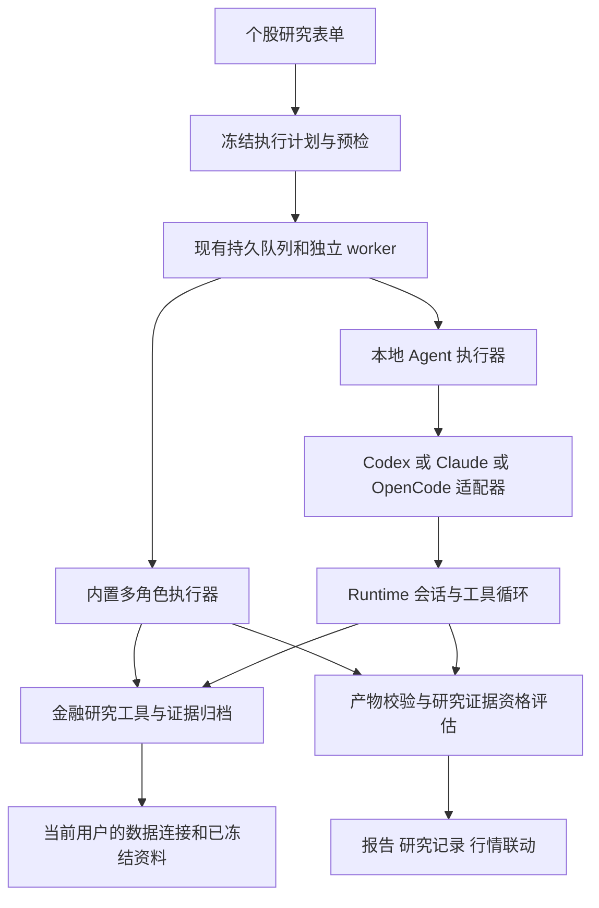

# 本地 Agent Runtime 与模型接入设计

更新日期：2026-10-28。设计版本：v2.1。当前已实现内置执行器拆分、Codex 0.164.x stdio连接及配置界面、受控金融工具、独立研究与报告闭环。独立研究Agent配置/技能、Claude/OpenCode、可靠会话恢复、混合研究和个人电脑连接器仍为后续方案。实际验收与部署进度以 [实现状态](web-execution-status.md) 为准。

本方案保留现有 TradingAgents 多角色研究、行情界面、多厂商模型连接及账号隔离，增加真正调用本地 Codex、Claude Code、OpenCode 等 Agent 工具的执行路径。用户可以选择由本系统编排研究，也可以委派已连接的 Agent 执行研究。两类执行共享证券身份、数据服务、证据归档与报告检索，分别保留实际执行过程。

本批可用入口为 `/workbench/settings/runtimes`，首个实际适配为Codex。本机执行只向原工作区主人开放，每个连接使用独立 `CODEX_HOME` 和系统密钥库授权，不继承其他Codex或模型连接的OAuth。用户也可复用自己已检测的Responses API模型配置。具体操作见[本机运行说明](web-local-operation.md#codex-runtime-独立研究)；以下目标设计超出本批交付的部分，按末尾阶段状态推进。

## 参照结论

本机应用为 HiFox，桌面包版本 0.4.464；界面另显示本地 CLI 0.4.467。已查看电脑详情、Runtime 诊断、未提交的 Agent 创建向导和本地服务页，并读取发布包中的可读界面与 IPC 契约。不同组件版本分别记录，不能将桌面版本当成 Runtime 版本。

HiFox 将电脑、本地服务、Runtime 和 Agent 分层：电脑提供环境，本地服务接收任务并准备工作目录，Runtime 执行，Agent 保存指令和配置，进展与结果返回任务。该链路同时得到其[电脑文档](https://help.hifox.com/docs/agent-and-computer/computers)支持。

| 参照设计 | 在本项目中的应用 |
|---|---|
| 电脑与 Runtime 分开，单机可有多个 Runtime | 明确运行机器、连接状态、执行器类型和账号归属 |
| 探测安装、路径、版本、模型、技能和可用状态 | 将“发现程序”“认证可用”“模型可用”“研究工具可用”分别检测 |
| Agent 保存职责、技能、运行位置与并发 | 增加可版本化的研究 Agent 配置，关联研究目标、工具和输出要求 |
| Runtime 默认配置、Agent 配置与单次模型选择分开 | 保留继承关系，并展示本次最终生效值和来源 |
| 排队原因、等待回复、运行记录和执行转录可读 | 研究页增加真实事件时间线、等待原因和明确的人机交接 |
| 机器并发、目录占用和资源管理独立 | 分开控制用户队列、机器容量、单个 Runtime 与单次研究预算 |

职责、技能和 Runtime 绑定见 HiFox 的 [Agent 配置](https://help.hifox.com/docs/agent-and-computer/agents)；排队、取消、转录和结果查看见[任务执行说明](https://help.hifox.com/docs/agent-and-computer/agent-task-execution)。

发布包还暴露独立 TokenHub 本地 AI 网关的管理接口，说明网关可以作为另一层能力。现有可读部分不足以确认其完整渠道表单或厂商适配，不能据此认定所有 Runtime 都能调用任意厂商。主进程和 daemon 内部未复原；也没有证据说明 HiFox 内置了与本项目等价的美股研究图或金融证据校验。这里借鉴其通用执行设计，并补上本项目的金融研究约束。

## 原有能力与本批改造

现有 `ModelConnection → ModelProfile → RoleBinding` 已支持不同模型供应商、四类 API 协议、自定义地址/请求头和按角色分配。它们应继续用于内置研究。

原有“ChatGPT 本机订阅授权”继续给 Python 模型客户端提供认证，由 LangGraph 调度角色与工具。新增Codex Runtime是独立执行路径，worker按运行清单选择内置图执行器或本地Agent执行器；模型连接不会被误当成一个CLI Agent。

本批将图生命周期提取到 `web/executors/builtin.py`，新增 `local_agent.py`、Runtime连接服务、stdio适配器和研究工具网关，前端增加 `features/runtimes` 及研究表单/详情分支。`dataflows/evidence.py` 的进程内捕获通过网关实际调用现有来源服务继续生效；外部Agent的内部模型调用次数仍未知，不能用LangChain回调推定。

## 产品结构

目标设置中心分为四类能力，证券、行情与研究记录的主导航保持现有定位。当前已提供模型服务、电脑与运行环境、数据配置；单独的研究Agent和技能管理尚未实现，本轮通过研究表单保存执行方式、连接和补充要求。

| 入口 | 用户配置什么 | 默认展示 |
|---|---|---|
| 模型服务 | 厂商/网关、协议、地址、认证、模型与检测 | 连接名、模型、聊天/工具能力、最后检测 |
| 电脑与运行环境 | 机器、连接器、Runtime、安装与认证状态 | 本机优先、可用与不可用原因、权限范围 |
| 研究 Agent | 研究职责、Runtime、模型覆盖、技能、工具、预算 | 名称、适用主题、执行位置、准备情况 |
| 工具与数据 | 行情、财报、新闻、宏观、期权等工具及账号 | 数据覆盖、来源、账号状态和调用范围 |

“模型服务”负责模型推理连接；“Runtime”负责执行完整工具循环。用户既可把 DeepSeek 模型用于现有 12 角色，也可在某个确认兼容的 Runtime 中选择该模型。表单根据实际能力显示选项，不把模型厂商和 Agent 工具放进一个混合供应商下拉框。

### 添加连接的向导

用户可进入已有模型设置，或进入新增“电脑与运行环境”连接本地Agent。当前Codex流程为：

1. 选择执行位置。本机指后端/worker 所在机器，界面显示名称和“服务器本机”；连接自己的另一台电脑时显示“个人连接器”。
2. 选择 Runtime，检测程序位置、版本和协议；展示最近一次检测时间。只读探测不启动研究。
3. 检查认证状态。Codex登录保存在本连接专属目录与系统密钥库，页面提供带独立 `CODEX_HOME` 的登录命令，由本人在终端完成，不读取已有全局授权。API凭据继续由系统模型连接配置管理。
4. 选择 Runtime 默认模型，或选择兼容的已有模型连接；展示精确模型 ID、来源和能力。自动列表缺失时可手填并标记“尚未验证”。
5. 核对研究工具和权限。本批固定六类只读金融工具与本次研究范围，不能通过任意shell、环境变量或提示词追加工具。
6. 点击“检测环境”只读探测程序、授权和模型清单，不启动推理。保存未检测配置可以完成，启动研究必须满足所需能力；实际模型、用量和来源在执行后核对。

“重试探测”“更新登录”“选择其他模型”“修复路径”分别处理，避免所有错误都被归为连接失败。安装、更新或修改可执行路径是明确操作，采用候选检测、版本校验、应用、复验的流程；普通用户不能向服务器提交任意命令。

### 研究 Agent 配置

一个配置可以叫“半导体产业链研究员”或“生物制药催化剂研究员”，保存职责、指令和工具集合。主题分类和证券池继续来自用户可编辑的主题模块，避免在 Agent 提示词里再写一份不易维护的股票名单。

基础字段为名称、适用主题、Runtime、默认模型、研究模板、允许工具、报告语言和运行预算。高级项包括思考档位、支持的子 Agent、受控计算工具、数据范围和输出结构。技能保存内容哈希与版本；更新技能不改变已启动研究，也不会自动授予新工具权限。

参数优先级为本次显式选择、研究 Agent 版本、Runtime 默认值。受管策略作为可用范围约束；不兼容或不允许的覆盖必须报出原因。不会悄悄忽略选择或改用其他付费服务。界面预览“生效配置”，分别标出继承、覆盖及未确定项；不继承任意宿主环境变量。

预览中的请求配置与启动后的实际配置分别保存。适配器核对 Runtime 回报的 provider、model 和认证来源；确认不一致时停止并说明，不自动接受模型回退。无法回报的字段标为 unknown，不将发出的参数冒充实际执行值；策略要求必须确认的字段未知时，预检或启动确认应阻止继续。

## 三种研究执行方式

| 模式 | 执行者 | 路径展示 | 交付顺序 |
|---|---|---|---|
| 内置多角色研究 | 现有 Python/LangGraph | 原有 12 角色和实际阶段/产出 | 继续作为默认，可回归验证 |
| 本地 Agent 研究 | 已连接 Runtime 的 Agent 循环 | Runtime 实际上报的步骤、工具和产物 | 首个新增闭环 |
| 混合研究 | 内置图与受控 Runtime 子任务 | 明确委派节点、关联子运行与内置复核 | 独立研究稳定后增加 |

本地 Agent 接到“研究 NVDA”后，不会仅凭一份长提示词就被标记为完成了本系统 12 角色。只有真实执行的角色或节点才显示完成。后续可将本地 Agent 委派给某个独立研究节点，再由内置多空辩论和风险讨论复核。节点需要独立输入、输出和工具边界；不在首版为每个角色启动一个完整 CLI。

创建研究表单先选执行方式，再根据模式显示研究模板或研究 Agent。切换前保留可复用的股票、日期、目标、期限和附加资料，专属配置分别保存。启动前确认实际机器、模型/认证来源、工具、信息截止时间、预算及运行目录；选择页面和刷新行情不会触发模型调用。

## 个股研究的执行链路

以 NVDA 研究为例，服务端先校验证券类型、用户和工作区，再冻结美东研究日期、目标、观察期限、主题成员版本、所选模型与工具。Agent 通过授权工具获取价格、财报、新闻和其他已配置数据，按证据编号引用；需要计算时调用受控计算工具或经批准的沙箱，不能仅凭模型记忆生成价格或财务数字。

研究可以输出行业位置、基本面、价量变化、市场情绪、催化剂、多空观点、风险和待核实项。实时/延迟行情、ETF 份额流估算、期权返回样本和新闻样本维持原口径。未接入来源继续缺失；某个通用 Agent 会搜索网页不意味着获得全市场情绪、实时盘口或可靠机构净买入。

最终产物经过结构校验、证券/日期一致性校验、证据引用及来源资格评估，再发布到原有报告库。进程退出成功、Agent 自述完成、格式正确和列出网址分别记录，不能直接推导研究证据合格或评级可用。财报公开时间、宏观修订、新闻时点和未知发布日期沿用现有历史研究边界；无法核实的资料标为回顾或待验证。

本地 Agent 计划另行冻结 `evidence_policy_version` 与必需来源类别，按研究目标要求价格、财报或新闻等证据。现有质量判断从 `request.analysts` 推导要求，不能将默认四分析师或空列表直接套给独立 Agent；没有适配资格策略的外部报告保持 unverified，策略版本变化不回写历史资格。

## 金融研究工具网关

新增 `ResearchToolGateway`，复用现有业务服务。内部使用有类型的 Python 工具契约，按 Runtime 能力暴露 MCP 或受控 RPC 适配。MCP 负责工具发现与调用；它不能替代启动 Runtime 的执行协议。

下表描述目标工具覆盖。本批实际开放价格、指标、公司资料、新闻、宏观和冻结补充资料六类动态工具；不直接开放任意URL、受控计算、文件工具或专业数据账号查询，后续新增能力需逐项验收。

| 工具组 | 初始范围 | 返回要求 |
|---|---|---|
| 证券和行情 | 证券身份、日线、支持的分钟线、技术指标 | 证券 ID、source/feed、口径、数据时点、覆盖和质量 |
| 公司与宏观 | SEC 财报、公司披露、FRED 等已接入来源 | 公开时间/观测时间、修订口径、缺失项 |
| 市场背景 | 已冻结的市场、行业和主题资料 | 股票池/成员版本、指标方法和有效覆盖 |
| 专业数据 | 期权、ETF 份额流、新闻样本 | 样本范围、实际/估算、账号权限和不确定性 |
| 产物和计算 | 读取本次资料、受控计算、写入研究产物 | 路径受限、大小限制、哈希、明确产物类型 |

每次工具请求绑定不可伪造的 `user/workspace/run/attempt` 能力及有效期。网关从已冻结的数据连接引用解析当前账号凭据，归档请求摘要、来源响应、接收时点和内容哈希；返回给 Agent 的是证据内容与编号，不下发 FRED、新闻等供应商密钥。

默认研究工具集不包含任意 shell、任意文件读取、任意 URL 代理、桌面控制或交易下单。新增工具需要声明能力及输出契约。外部网页、新闻、附件、技能和工具响应作为待分析资料，不得改变运行权限或读取其他账号凭据。Runtime 能绕开工具网关自行联网时，该部分只能作为额外线索；没有捕获到原始来源的内容不能冒充已验证证据。

研究目录隔离只是文件组织方式。要限制一个拥有 Bash/文件工具的外部 Agent，必须同时落实 Runtime 工具限制、访问控制或 OS/容器沙箱；仅指定 `cwd`、设置提示词或设置允许列表不足以保证隔离。不能提供相应约束的执行器，只可用于主人明确启用的扩展模式，并显示较低的可验证范围。

## 模型服务商和 Runtime 的兼容关系

| 接入路径 | 建议实现 | 可选择的模型 | 主要约束 |
|---|---|---|---|
| 内置研究 | 保留当前模型适配器 | 各已适配厂商及自定义模型服务 | 检测实际启用角色所需聊天、工具等能力 |
| Codex Runtime | 官方 app-server，优先受控 stdio 连接 | Runtime 返回的可用模型；兼容自定义 Responses 服务 | 不能把仅 Chat Completions 的服务直接当成 Codex 后端 |
| Claude Agent | 官方 Python Agent SDK 作为首选集成路径，CLI 兼容模式另行验证 | 官方支持的模型与兼容网关 | API、云平台或网关认证单独配置；不默认继承或提供订阅授权 |
| OpenCode Runtime | 支持版本对应的 headless HTTP 接口 | Runtime 支持的厂商和模型清单 | 配置格式按 Runtime 版本区分，协议和工具能力分别检测 |
| 已有本地/远程网关 | 作为普通模型连接或兼容 Runtime 的上游 | 网关实际提供的模型 | 网关地址、认证、模型权限和协议均需验证 |

Codex 官方 [app-server](https://developers.openai.com/codex/app-server) 提供会话、回合、事件、取消和审批协议，适合做可观察的本地适配器；首版使用 stdio，避免将原始 Agent 控制接口暴露给浏览器。自定义供应商的当前 `wire_api` 支持范围以[配置参考](https://developers.openai.com/codex/config-reference)为准，当前为 Responses。检测结果绑定实际 CLI 版本，不用最新文档推定旧安装必然支持。

Claude 的 [Agent SDK](https://code.claude.com/docs/en/agent-sdk/overview) 提供工具循环、会话与权限集成，但官方对第三方产品提供 claude.ai 登录/订阅额度有授权要求，因此本方案不承诺直接把 Claude 订阅接入产品。支持的 API 或云平台认证、已有网关及协议兼容性按其[网关说明](https://code.claude.com/docs/en/llm-gateway)检测；仅改地址不会统一认证或计费方式。

OpenCode 的[供应商配置](https://opencode.ai/docs/providers)和[服务端接口](https://dev.opencode.ai/docs/server/)提供另一种多厂商 Agent 入口。适配器固定支持的版本和配置 schema，不混用不同代的配置字段。复用用户已有网关即可，首期无需另建渠道计费或 TokenHub 服务。

页面中始终区分三类凭据：Web 登录会话、Runtime/机器配对身份、模型及数据供应商凭据。调用 Runtime 不保证免费；API Token、订阅额度和用量未知分别显示。未来产品化的 ChatGPT 账号接入按官方支持的用户授权方案重新核验，不能把本地主人的 app-server 登录当成商业托管服务的共享认证。

### 两种配置所有权

本批提供“本连接专属Codex登录”和“当前账号的Responses模型连接”。前者由本人使用页面给出的命令维护独立认证，后者复用受控模型连接的地址、认证和模型ID；仅接受额外 `parameters` 为空且聊天/工具检测通过的配置，思考档位在Runtime连接内单独设置。不直接继承宿主的全局登录、模型环境变量、MCP、插件或指令。

适配器无法控制某字段时明确不支持，不自动改写用户全局配置，也不默默丢弃参数或回退另一份授权。未来若增加其他Runtime的配置继承，须单独验证其配置、认证和工具隔离。

## 技术分层与数据对象

保留 React、TypeScript 7、Vite、TanStack Query、Ant Design、Orval 和 Oxc 工具链，保留 Python/FastAPI、SQLAlchemy、Alembic、SQLite 与独立研究 worker。此次需求增加执行边界，不要求改成 Next.js、Electron、微服务或另加 Redis。

| 对象 | 关键内容 |
|---|---|
| `ExecutionHost` | 用户/工作区、机器身份、连接模式、心跳、版本、可用容量、授权代际 |
| `RuntimeConnection` | host、执行器类型、适配传输类型（stdio app-server、HTTP、SDK、CLI）、受控路径/地址、程序与协议版本、认证状态、能力、revision |
| `AgentExecutionProfileVersion` | Runtime 引用、职责/技能版本、模型来源、工具集、权限、目录策略与预算 |
| `ResearchExecutionPlan` | 模式、计划版本、角色/子任务、配置引用、execution_host、凭据执行位置、证据策略版本和所需能力 |
| `RuntimeSession` | user/workspace/run/attempt、远端 session/thread/turn 引用、执行代际和实际状态 |
| `ToolCapability` | 工具范围、运行归属、有效期、撤销及租约约束，秘密仅保存引用/摘要 |
| `RuntimeOperation` | 连接、探测、路径应用等操作的幂等键、revision、状态、超时与结果查询 |

上表是目标对象划分。本批新增 `agent_runtime_connections` 表，执行计划和证据策略冻结在现有manifest中，运行事件和实际模型元信息沿用有归属、租约校验的事件/报告存储；独立机器、Agent配置版本、可恢复会话和远程操作对象尚未全部建表。

`ResearchExecutor` 统一提供预检、启动、事件消费、取消、恢复探测和产物收集。实现 `BuiltinWorkflowExecutor` 与 `LocalAgentExecutor`；具体 Runtime 的协议放入独立适配器。不要让 CLI 假装成 `.bind_tools()` 模型客户端，也不在 API 请求线程内运行长研究。

实际新增实现位于后端 `web/domain/agent_research.py`、`web/application/runtime_connections.py`、`web/executors/`、`web/infrastructure/agent_runtimes/` 和 `web/application/research_tools.py`。前端新增 `features/runtimes/`，`features/research-agents/` 尚属后续；公开契约通过OpenAPI/Orval生成，新增Runtime SSE事件也有显式schema。

运行清单新增执行模式、执行器/协议版本、Runtime 及 Agent 配置 revision、技能/指令/工具集哈希、权限版本、模型生效来源、数据连接与资料快照。密钥、机器配对码和完整宿主配置不进入清单。已保存运行保持不可变，旧清单显式识别为 `builtin_workflow`。

迁移以新增表和可兼容的字段为主，旧研究默认仍走内置执行器；历史报告继续可读。旧 LangGraph 检查点保留现有代码/图兼容校验，重构可能使其无法继续，不能为了新执行器放宽旧签名。发布前等待在途研究结束并备份；新增 Runtime 连接默认禁用，M4.0先通过现有离线回归，再分阶段启用。

## 事件 状态 与报告界面

执行状态、等待原因、连接健康和研究质量分别保存。已有 Run 状态继续作为主生命周期，增加可空 `wait_reason`，如 `approval`、`user_input`、`resource`、`reconnect`；Runtime 内部状态另外记录。暂停等待是否计入预算按预算类型明确：活动时长、总时长和等待上限分开。

等待与交互字段为后续扩展。本批沿用既有Run状态，新增经过白名单过滤的Runtime事件，保存请求/实际模型、认证来源和执行器版本；未授权审批或未知服务请求直接拒绝并结束，不提供自动批准或交互续跑。

统一事件包含序号、run/attempt、执行代际、来源事件 ID、时间、类型及安全载荷。事件至少覆盖会话启动、公开步骤、工具请求/结果、等待授权、用户回复、产物、用量、错误与终态。上游有稳定事件 ID 时去重；没有时使用适配器会话内序号并说明恢复覆盖。不展示隐含思维链，将公开计划、动作、工具结果和报告作为可视化依据。

研究详情左侧显示实际路径，中间显示步骤/工具/等待时间线，右侧显示证据和运行配置；报告另设结果视图。内置图沿用已有的计划路径，并继续区分阶段范围与真实角色事件；Runtime 无角色信息时不推断角色起止。不用聊天消息数量推算进度或计费。

审批只对应一次具体操作，记录请求内容哈希、运行代际、用户决定、有效期和执行结果；撤销的会话或过期的 worker 无法继续使用旧批准。原始日志不直接回显供应商错误、环境变量、密钥或完整敏感路径；提供可审阅的脱敏诊断。

首次 Runtime 接入即实行审批默认拒绝/等待。适配器不支持交互审批时，超出预授权范围的动作直接拒绝，不自动确认。对取消、租约丢失或确定中断的运行撤销工具能力；断连进入待确认时暂停新工具调用，重新校验有效代际后才允许恢复。

产物发布经过现有租约 fencing 检查、大小和路径/符号链接校验、内容哈希及 HTML 安全处理。模型生成的 Markdown/HTML 不可获取浏览器脚本权限，也不能将宿主任意路径注册为下载文件。

## 取消 恢复 与预算

取消先写入现有持久状态，再调用 Runtime 的取消接口；等待明确终态。必要时终止本次受控子进程组并回收资源，绝不按进程名杀死用户的其他 Codex/Claude 会话。取消不撤销已发生的模型用量。

“请求已接受”“Runtime 已开始”“产物已发布”分别记录。连接中断且无法确认是否启动时进入待确认状态，按 request/session ID 查询，不能自动重新提交一次研究。外部调用不承诺恰好一次，数据库的幂等键和唯一活动 attempt 继续生效。

LangGraph 检查点和 Runtime 会话分开存储。只有相同归属、配置/权限/协议兼容且 Runtime 支持恢复时，才在新 attempt 中接续原会话；否则提供重新研究。不能用重新发送同一提示词冒充恢复。

当前Codex模式明确拒绝resume，取消/超时会请求中断并回收本次进程组，断连或启动结果不确定时不自动重试。界面的“重新研究”保留执行方式和连接供复核，提交后生成新任务。可靠会话恢复和等待交互属于M4.3。

按主机、Runtime、用户和研究分别限制并发/队列、活动时间、工具请求、输出大小及可获得的 Token/费用。首版单机 Runtime 默认并发 1，逐适配器验证后增加；保留当前每账号 3 个待处理任务与全局 50 个排队任务。未知用量显示 unknown，不记为零；无法观测内部模型轮次时，明确哪些预算可硬执行、哪些仅为估算。达到硬限额时由应用中断，不只依赖提示词要求自律。

## 本机与朋友使用的边界

当前 API 和研究 worker 继续作为两个常驻业务进程。本机模式由 worker 内的适配器启动按需的 Runtime 子进程或连接本人明确选择的服务；不是再启动一套工作台。研究目录按 user/workspace/run/attempt 组织。单机首版无需新增常驻 daemon，也不开放机器任意 shell 服务。

朋友在同一 Web 服务注册，只能访问自己的模型和资料，不自动获得主人的 CLI 登录、主目录、插件或运行权限。按目录分组不能替代 OS 身份隔离。共享机器上的非主人执行需要独立 OS/容器执行身份及显式授权；在这些能力未完成前，不开放该类借用。

后续朋友可以在自己的机器运行个人连接器。连接器使用一次性配对流程绑定账号和机器，持有可撤销的设备凭据，以主动建立的认证连接接收受限任务；浏览器不直接请求未认证的 localhost Agent。配对凭据与首次管理员初始化码属于不同用途。

执行计划冻结工具和凭据的权威位置：由服务器网关执行，或由个人机器网关执行。个人机缺少凭据时失败并提示配置，不回退服务器上同名的数据/模型连接。连接器 API 使用独立设备权限和请求校验；浏览器设置继续使用现有用户会话与CSRF，不通过客户端填写 user/workspace 获得授权。

远端调度按机器可用性和容量租约领取任务。离线机器的任务保留可解释的等待原因及到期策略，不占住当前单 worker 长时间等待连接；有资格执行的其他用户/机器任务应继续被领取。活动远程运行与本机子进程分别计入容量，重连不能产生第二个活动执行实例。

远端部署前明确控制面、事件和产物上传的目的地与范围；模型/数据凭据优先留在各自机器。本地工具响应和研究资料可能跨机器传递，不能仅因模型在本机运行就宣称数据不会离开设备。断开配对、改密/注销与运行取消是独立操作，分别定义效力。

## 实施顺序与验收

| 阶段 | 当前状态 | 任务与验收边界 |
|---|---|---|
| M4.0 | 已完成当前范围 | 图生命周期提取为内置执行器，保留队列/租约、取消、导出及原检查点兼容保护 |
| M4.1 | 连接与界面已完成 | Runtime CRUD/CAS、独立认证目录、只读探测、模型绑定及研究方式选择；独立研究Agent配置/技能另待实现 |
| M4.2 | Codex代码闭环完成 | 0.164.x stdio、六类金融工具、实际模型确认、独立证据策略、严格JSON报告和产物；审批默认拒绝、取消/超时回收及不自动重试；真实供应商研究待本人配置后显式验证 |
| M4.3 | 待开始 | 可靠会话恢复、审批/用户输入界面和等待交互；不重发已启动任务，等待有界结束 |
| M4.4 | 待开始 | Claude/OpenCode协议、认证、模型与工具适配，不以类型预留冒称可用 |
| M4.5 | 待开始 | 单节点委派、个人连接器、机器调度与授权；跨用户/机器能力隔离及离线不阻塞 |

先实现 Codex 是因为本机 HiFox 界面已报告其可用，并且用户已有 ChatGPT 使用场景。该信息仅用于实施排序；接入时仍需由本项目独立检测具体路径、版本、认证与所需能力。选择 Claude 或 OpenCode 不要求迁移模型、主题或历史研究。

关键验收覆盖：未安装/未登录、错误程序、版本不支持、检测失效、模型/协议不匹配、手工模型 ID、Runtime 全局配置冲突、工具权限不足、数据源缺失、跨账号/会话/产物访问、未知用量、预算超限、等待超时、进程/服务断连、取消进程树、恢复兼容、迟到事件、重复任务、文件路径穿越和未归档证据。离线适配器验证与本人显式发起的真实模型验证分别记录，不能用假事件或通用网页引用宣称真实研究已接通。

## 本轮变更范围

本轮新增Codex Runtime代码、0012迁移、配置与研究界面、金融工具网关和独立执行器，原有12角色流程保留。外部报告检查严格JSON、股票/日期及本次 `snapshot:<id>` 引用，并强制保持未经独立核验的原始研究观点，不发布有效评级、已验证价位或仓位。

验证包含离线服务/worker/协议回归，以及真实Codex `0.164.0-alpha.11.1` 连接隔离本机假Responses服务的3项集成测试；没有使用真实厂商密钥或模型推理。实际账号连通与个股研究由本人完成专属Runtime登录或API配置后显式启动。最终全量门禁和生产迁移/重启结果记入[实现状态](web-execution-status.md)，不将测试服务结果当成真实模型研究。
